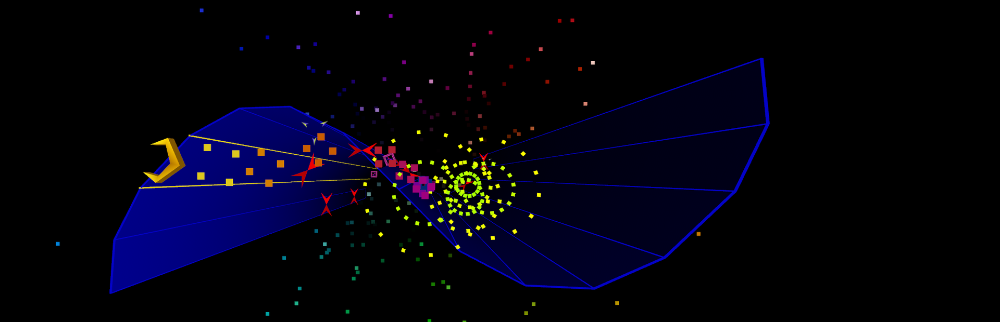

# Tempest 2032

A Tempest 2000 clone with graphics for modern hardware.

The goal is to make Tempest 2000 easy to install and play on today's computers,
preserve its exact gameplay, and update the graphics for modern GPUs and
high-resolution displays.



## Install and play

Download your platform's package from [GitHub Releases](https://github.com/glehmann/tempest2032/releases).
Then:

- **Windows:** run the setup `.exe`. It installs for your account and adds a Start
  menu shortcut. No administrator access is required.
- **macOS, Apple Silicon:** open the `.dmg`, drag **Tempest 2032** into
  **Applications**, and open it from there.
- **Linux, x86_64 or arm64:** extract the `.tar.gz`, copy its folder anywhere,
  and run `tempest2032`. The tarball needs glibc 2.39 or newer and system audio,
  display, and graphics libraries.
- **Linux Flatpak:** open the `.flatpak` bundle in your software center, or run
  `flatpak install --user ./tempest2032-linux-x86_64.flatpak`, using the arm64
  bundle on arm64 machines. Launch **Tempest 2032** from your applications menu.

The macOS app and Windows installer are not publisher-signed yet. On macOS,
use **Open Anyway** in System Settings → Privacy & Security if Gatekeeper blocks
the downloaded app.

Windows shortcuts, the macOS app, and Flatpak start in fullscreen.
All game assets and levels are included. Linux needs a graphical desktop and a
Vulkan-capable graphics driver.

The welcome screen shows the top ten scores for your selected difficulty.
Press Enter or controller A to play, or P / Start to configure difficulty and
install in Steam. Difficulty and three-letter high-score initials are saved.

Note: Development builds are available under **Artifacts** in successful
[Application packages workflow](https://github.com/glehmann/tempest2032/actions/workflows/packages.yml)
runs for three days.

### Build from source

Install [Rust](https://rustup.rs/) 1.89 or newer and run from the source directory:

```sh
cargo run --release
```

The first build takes a while. To build a standalone executable:

```sh
cargo build --release
```

You'll find it at `target/release/tempest2032`, or
`target/release/tempest2032.exe` on Windows. It runs without the source tree.

On Debian or Ubuntu, install the build dependencies first:

```sh
sudo apt install build-essential pkg-config libasound2-dev libudev-dev \
  libx11-dev libxi-dev libxrandr-dev libxcursor-dev \
  libxkbcommon-dev libwayland-dev
```

### Play in a local browser

A WebGL2 browser build is available from source. Follow the
[browser build instructions](docs/reference.md#local-browser-build), then open
the local page and click Play. Settings and high scores stay in that browser.

### Add to Steam

Choose **Install in Steam** in the welcome screen's configuration menu, then
restart Steam. You can also close Steam and run:

```sh
cargo run --release -- --steam-install
```

This installs a standalone copy and adds it to your Steam library as a non-Steam
game, with artwork and fullscreen launch options. Open Steam to see it. Supports
Steam Deck and native, Flatpak, and Snap Steam installations.

## Controls

Controller buttons use Xbox names.

| Action | Keyboard | Controller |
| --- | --- | --- |
| Move | Left/right arrows or A/D | D-pad or left stick |
| Fire | Hold Z or Space | Hold A |
| Jump, once unlocked | X | B, left trigger, or left bumper |
| Superzapper | C | X, right trigger, or right bumper |
| Pause/resume | P or Pause | Start |
| Restart | Restart in the pause menu | Restart in the pause menu |
| Return to Welcome | Esc during gameplay or Exit in the pause menu | Exit in the pause menu |
| Quit | Esc on Welcome | B on Welcome |

Use up/down and confirm with Enter, Space, or controller A in the pause menu.
Esc resumes when paused. In warp stages, steer with the arrows, W/A/S/D, D-pad,
or left stick.
Enter confirms menus and does not fire. In Steam Input, use a Gamepad layout
to keep the same controller controls on Steam Deck and other Steam controllers.

For high-score initials, type three letters or use left/right to select a slot
and up/down to change its letter. Enter / A saves; Backspace / B erases.
On Steam Deck, open the virtual keyboard with Steam + X.
Initials follow your OS keyboard layout; gameplay bindings use physical key positions.

## Options

```sh
cargo run --release -- --fullscreen
cargo run --release -- --level 17 --difficulty low
cargo run --release -- --volume 0.3 --music-volume 0.5
cargo run --release -- --help
```

Difficulty initially defaults to `normal`, then remembers your menu selection.
`--difficulty` overrides it for that launch. `--level` and `--warp-zone` skip the
welcome screen and disable high-score saving, including `--level 1`.
Optional TOML files in `levels/` override the embedded levels; changed definitions
also disable high-score saving.

## Development

```sh
cargo fmt --check
cargo check
cargo test
cargo clippy -- -D warnings
```

The [reference guide](docs/reference.md) covers level customization, capture
tools, asset generation, and gameplay and rendering details.

## About this project

Project-authored code, documentation, and artwork are licensed under
[GNU GPLv3](LICENSE). Imported Tempest 2000 assets are excluded from that grant;
their redistribution permission has not been established. See [NOTICE](NOTICE)
for the affected files, third-party attribution, and mixed or derived material
that still needs review.
Original source reference: [mwenge/tempest2k](https://github.com/mwenge/tempest2k).

Built mostly with OpenAI's Sol 6.1 at medium reasoning effort, with some work
by Space Bunny at high reasoning effort.

2032 is a nod to Tempest 2000, which was released in 1994, six years before
the year in its name. Tempest 2032 follows the same convention for 2026.
